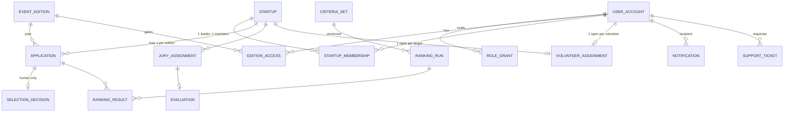

# Startup Jathara Platform — Technical Execution Plan

Zeny2Labs · v0.2 · 15 October 2026 · Source of truth: **Startup_Jathara_PRD_v1.1**. IDs (FR-, AT-, TBD-, DC-) refer to the PRD. Every TBD now has a recorded decision in [DECISIONS.md](DECISIONS.md); most await approval.
Labels: **Decided** = engineering decision (change via ADR); **Awaiting approval** = recommended decision in DECISIONS.md that a stakeholder must approve; **Blocker** = stops a milestone.

**Situation.** 21 days to the 2026 registration deadline (5 Nov 2026); 63 days to the pre-event day (17 Dec 2026). No code existed before this repo, no GitHub account is linked to this workspace, and no project-owned cloud accounts exist yet. Team capacity is unconfirmed; the schedule below assumes **at least three full-time engineers**. With fewer, M6–M8 are at risk (see §8).

---

## 1. Stack (Decided unless marked)

| Area | Decision | Why |
|---|---|---|
| Language | TypeScript everywhere, Node 22 LTS | One language for web, API and mobile; validation schemas shared through `packages/contracts`. |
| Repo | pnpm workspaces monorepo | Atomic changes across API, web and contracts; one CI. |
| API | **Fastify 5 modular monolith**, Zod at every boundary, `postgres` SQL client, SQL-first migrations | Small and fast. Explicit SQL keeps the PRD's integrity rules visible in the schema (DC-01…13) rather than hidden in an ORM. The PRD's modular-monolith default is kept. |
| Database | **PostgreSQL 16+**: Supabase managed Postgres, Mumbai (ap-south-1), separate staging and production projects | Relational constraints for unique applications and one-to-one volunteers; partial unique indexes; India region. |
| Identity | **Supabase Auth** as identity provider (email OTP and phone OTP; TOTP MFA). The API verifies JWTs via JWKS and owns all authorisation in its own tables | No passwords in our code (FR-IAM-08). Email and phone (TBD-12): email from launch, SMS once the DLT sender is live. Staff MFA (FR-IAM-11). |
| Web | **Next.js 16 / React 19**: `apps/web` (public site + applicant pages) and `apps/console` (Admin, Management, Support areas, each role-gated, deployable on its own subdomain) | Server rendering for public pages. One console codebase replaces the PRD's "three separately deployed dashboards" (Proposed default). Separation is enforced by API authorisation and per-area gates. |
| Mobile | **Expo (React Native)**, one codebase; EAS Build/Submit; `expo-notifications` (FCM/APNs) | One app for Android and iOS (RQ §1). Shares TypeScript contracts. Content stays server-driven (FR-EVT-02). |
| Background jobs | **pg-boss** (Postgres-backed queue) | Notifications, imports, ranking runs and retries without adding Redis. |
| Files | Supabase Storage, private buckets, short-lived signed URLs | SEC-08. |
| AI | Provider adapter with **separate keys, config and service identity** for Ranking and Help Desk. Vendor: **Google Vertex AI** in the hosting project (TBD-35, awaiting contract approval) | FR-RNK-12 and FR-HD-20 independence; replaceable vendor. |
| WhatsApp | WhatsApp Business Platform, **Meta Cloud API directly** (no BSP), behind an adapter (TBD-35) | FR-HD-01, FR-HD-03. |
| Email, SMS | **Amazon SES (ap-south-1)** as SMTP for Supabase Auth and API mail; SMS through a **DLT-compliant Indian aggregator** (default MSG91) via Supabase's Send SMS hook (TBD-35) | Supabase's built-in email is not for production; Indian SMS needs DLT registration. |
| Hosting | API + workers: containers on **Google Cloud Run asia-south1**. Web/console: **Vercel (bom1)**. DB/Auth/Storage: **Supabase ap-south-1** | Managed, scale-to-zero, India regions, minimal ops for a small team. **Recommended (TBD-46); awaiting budget approval and organisation-owned accounts (TBD-36).** Vercel Pro, because Hobby is non-commercial only. |
| Observability | pino JSON logs → Cloud Logging; Sentry (web, API, mobile); uptime checks | NFR-14. |

## 2. Environments and deployment

| Env | Purpose | Data | Deploy |
|---|---|---|---|
| local | Development | Seeded synthetic data; local Postgres (`scripts/dev-db.sh` or Docker) | `pnpm dev` |
| ci | Every PR | Fresh database per test file | GitHub Actions |
| staging | Acceptance, load and restore tests | Synthetic only; never production copies | Auto on merge to `main` |
| production | Live | Real | Tagged release + manual approval; migrations run before traffic shifts |

- **Secrets:** GitHub Actions secrets, GCP Secret Manager and Vercel environment variables, separate per environment. `.env.example` only in the repo. Service keys are least-privilege and rotated after the event.
- **Release safety:** Vercel preview per PR. Cloud Run revisions with instant rollback. Change freeze from 15 Dec; on-call 17–20 Dec (PRD §9.5).

## 3. Repository and module boundaries

```
apps/api          Fastify modular monolith (src/modules/*, src/platform/*)
apps/web          Public website + applicant pages (Next.js)
apps/console      Admin / Management / Support dashboards (Next.js)
apps/mobile       Expo app (M6)
packages/contracts  Zod schemas + types shared by API and clients
packages/client     Typed API client (web, console, mobile)
packages/web-session  Browser sign-in: dev tokens locally, Supabase OTP in staging/production
db/migrations     Forward-only numbered SQL migrations (source of truth for schema)
scripts/          dev-db.sh, e2e_smoke.py (browser end-to-end)
docs/             This plan; ADRs as decisions change
```

Rules:
1. Each module owns its tables and exposes service functions; no module queries another module's tables.
2. Every edition-scoped query takes the edition explicitly.
3. Routes declare a permission; the default is deny.
4. AI modules run under their own service identity with no decision privileges (DC-02 is also enforced by a database trigger).

## 4. API conventions and boundary plan

- REST + JSON under `/v1`; camelCase JSON; ISO-8601 UTC timestamps (UI shows IST).
- Audience prefixes:

  | Prefix | Audience |
  |---|---|
  | `/public` | No authentication |
  | `/me` | Any signed-in user, own data only |
  | `/editions/{year}/…` | Requires edition access |
  | `/manage` | Management |
  | `/admin` | Admin |
  | `/support` | Customer Support |
  | `/webhooks` | Signed provider callbacks |

- Errors use `application/problem+json`: `{type, title, status, code, detail, errors[]}` with a stable `code`.
- Cursor pagination. Unique constraints plus `Idempotency-Key` for creates that send messages.

| Module | Endpoints (v1) | Milestone |
|---|---|---|
| editions | `GET /public/editions` (server-computed registration windows) | M1 ✅ |
| registration | `POST /me/registrations` · `GET /me/applications` · `GET /me/notifications` · `GET /editions/{y}/me` (edition-gated) | M1 ✅ |
| selection | `GET /manage/editions/{y}/applications` · `GET /manage/applications/{id}` · `PUT\|DELETE /manage/applications/{id}/decision` · `POST /manage/editions/{y}/decisions/release` · `PUT /manage/editions/{y}/selection-limit` · corrections: `GET /manage/editions/{y}/corrections` · `POST /manage/applications/{id}/corrections` · `POST /manage/corrections/{id}/approve\|reject\|cancel` · `POST /me/applications/{id}/withdraw` | M1 ✅ · corrections and withdrawal ✅ Phase 5 |
| identity/admin | `POST /admin/imports` (preview) · `POST /admin/imports/{id}/commit` · `/admin/users` · `/admin/users/{id}/roles` · `/admin/users/{id}/activation` | M2 |
| ranking | `GET\|POST /manage/editions/{y}/criteria-sets` · `POST /manage/criteria-sets/{id}/approve` · `GET\|POST /manage/editions/{y}/ranking-runs` · `GET /manage/ranking-runs/{id}` · `PUT /manage/ranking-runs/{id}/cut-line` | M3 ✅ (Phase 5) |
| jury | `GET /manage/editions/{y}/jury` · `POST /manage/editions/{y}/rubrics` · `POST /manage/rubrics/{id}/approve` · `POST /manage/editions/{y}/jury-assignments` · `DELETE /manage/jury-assignments/{id}` · `POST /manage/editions/{y}/pitch-slots` · `PUT\|DELETE /manage/pitch-slots/{id}` · `POST /manage/pitch-slots/{id}/start\|finish` · `GET /manage/editions/{y}/evaluations` · `POST /manage/evaluations/{id}/reopen` · jurors: `GET /editions/{y}/jury` · `GET /editions/{y}/jury/startups/{id}` · `PUT /editions/{y}/jury/startups/{id}/evaluation` · `POST …/evaluation/submit` | M4 ✅ (Phase 6) |
| volunteers | `GET /manage/editions/{y}/volunteers` · `POST /manage/editions/{y}/volunteer-runs` · `GET /manage/volunteer-runs/{id}` · `POST /manage/volunteer-runs/{id}/approve\|discard` · `POST /manage/editions/{y}/volunteer-assignments` · `POST /manage/volunteer-assignments/{id}/reassign\|close` · participants: `GET /editions/{y}/volunteer/assignment` · `GET /editions/{y}/me/volunteer` | M4 ✅ (Phase 6) |
| content & notices | public: `GET /public/editions/{y}/event` · `GET /public/editions/{y}/documents/{id}/link` · participants: `GET /editions/{y}/event` · `GET /editions/{y}/documents/{id}/link` · console: `GET\|POST /manage/editions/{y}/content` · `PUT /manage/content/{id}` · `POST /manage/content/{id}/publish\|discard-draft\|archive` · `GET /manage/content/{id}/versions` · `POST /manage/editions/{y}/documents` · `POST /manage/documents/{id}/archive` · `GET /manage/documents/{id}/link` · notices: `GET\|POST /manage/editions/{y}/notices` · `POST …/notices/preview` · `PUT /manage/notices/{id}` · `POST /manage/notices/{id}/withdraw` · `POST /manage/editions/{y}/notice-groups` · `POST\|DELETE /manage/notice-groups/{id}/members` · own: `POST\|DELETE /me/push-tokens` · `POST /me/notifications/{id}/read` | M5 ✅ (Phase 7) |
| help desk & support | `POST /helpdesk/messages` · `GET /helpdesk/conversation` · `POST /helpdesk/conversations/{id}/escalate` · `POST /editions/{y}/emergency` · `GET\|POST /me/tickets` · `POST /me/tickets/{id}/notes` · `GET\|POST /support/tickets` · `POST /support/tickets/{id}/acknowledge\|status\|assign\|notes\|contact\|escalate\|priority` · `GET /support/requesters` · `GET /support/alerts` · `POST /support/alerts/{id}/seen` · `GET /support/editions/{y}/policy` · `PUT /manage/editions/{y}/support-policy` · WhatsApp webhooks: separate workstream | M7 ✅ app channel (Phase 8) |
| reports & audit | `GET /manage/reports/{id}` · `GET /admin/audit` · exports | M2–M8 |

## 5. Data model

Schema source of truth: `db/migrations/0001_foundation.sql` (M1 tables) and `0002_operations.sql` (tables for M2–M7, created now so the hardest rules are enforced and tested from day one).



| Rule (PRD) | Enforcement |
|---|---|
| DC-01 One application per startup per edition | `UNIQUE (startup_id, edition_id)` |
| DC-02 Only a human with management permission decides | FK to `user_accounts` + trigger `enforce_decider_is_management` |
| DC-03 Editions independent | Decisions are keyed by application, never by startup |
| DC-04/05/06 Volunteer one-to-one | `CHECK num_nonnulls(target_startup_id, target_jury_user_id)=1` + three partial unique indexes on open assignments |
| DC-07 Reassignment keeps history | Rows are closed, never updated in place |
| DC-08 Four ticket statuses | `CHECK status IN (…)` |
| DC-09 No passwords | No password column anywhere; identity provider holds credentials |
| DC-13 Audit append-only | Trigger rejects `UPDATE`/`DELETE` on `audit_events` |
| Released decision immutable (TBD-37) | Trigger blocks outcome change after `released_at`. The two-person correction process (decision TBD-37) is added in Phase 5 |
| Application form frozen once an edition has applications (TBD-39) | Trigger `event_editions_form_frozen` (migration 0007) |
| One leader per startup | Partial unique index on `startup_memberships` |

2027 event dates and deadline stay `NULL` until Management sets them (TBD-05). The 2026 cut-off is seeded as `2026-11-05 23:59:59 IST`, the recommended value (TBD-11), and stays flagged `closes_at_confirmed=false` until the organisers confirm it in writing (**Blocker for launch**).

## 6. Authentication, roles, permissions and edition isolation

| Mechanism | How it works |
|---|---|
| Identity | IdP subject ↔ `user_accounts.auth_subject`. Applicants self-register via the IdP. Token claims are never trusted as proof of verification (`user_metadata` is user-editable; amr `otp` covers both email and SMS). For a subject not yet linked, the API reads the user record from the Supabase Admin API (server-side service-role key) and treats an email or phone as proven only if `email_confirmed_at` / `phone_confirmed_at` is set and matches the token. Outage → 503, never a guess. |
| Account linking | Pre-created (staff, imported) accounts link on first sign-in only through a **proven** identifier, only if unlinked and not deactivated. Refused and audited (`identity.link_refused`): email and phone pointing at different accounts, several candidates (shared mobile), or a phone match on an account whose email on file was not proven. New applicant accounts store only proven identifiers; no proven identifier → 403 `identity_unverified`. |
| Activation | Enforced in `resolvePrincipal` before roles or edition access load: `pending_activation` → 403 `account_not_active`, `deactivated` → 403 `account_deactivated`, any unknown state → 403. Pending accounts link on sign-in but stay locked until the activation flow (B-09) exists. DB backstops (migration 0003): decisions and releases need an **active** management account; no new grants or edition access for deactivated accounts. |
| Roles | The 8 PRD roles are stored in `role_grants` (optional edition scope, revocable). Code maps roles to permissions (`apps/api/src/platform/permissions.ts`). |
| Admin ≠ Management | Admin has **no** management permissions unless also granted `management` (FR-IAM-06). Tested. |
| Relationship checks | Own startup and own applications (M1); assigned startup, target and ticket (M2+). |
| Edition isolation | `edition_access` gates participant features per year: predefined import → access; management selection → access (FR-IAM-12). 2027-only applicants never get 2026 access (AT-09). All edition data carries `edition_id`; staff endpoints take the year in the path. |
| Staff MFA | `REQUIRE_STAFF_MFA=true` (staging and production) rejects staff tokens without `aal2`. |
| Applicant view | Drafts and internal states are never exposed. Applicants see *Under review / Selected / Not selected* only after release (FR-SEL-09). |

M1 permissions:

| Permission | Roles |
|---|---|
| `registration.submit`, `application.read_own`, `notification.read_own` | Any authenticated user |
| `application.read_all`, `decision.draft`, `decision.release`, `selection_limit.configure` | `management` |

## 7. Engineering practices

| Practice | Approach |
|---|---|
| Testing | Vitest. Unit tests for services. API integration tests against **real Postgres** (fresh database per test file). Browser end-to-end script with Playwright (`scripts/e2e_smoke.py`), moved into CI in M2. Test names cite AT IDs. A PR must not reduce AT coverage. |
| CI | `.github/workflows/ci.yml`: install → typecheck → migrate a fresh DB → tests → build web and console. Dependabot and secret scanning to be enabled on the GitHub repo. |
| Migrations | Forward-only, numbered, applied in a transaction and recorded in `schema_migrations`. Destructive changes are two-step. |
| Logging | Structured JSON with request id and actor id. Authorisation headers, tokens and OTPs are redacted. Log user ids, not emails or phone numbers. |
| Security | helmet, CORS allowlist, rate limits on registration and sign-in, OWASP ASVS L2 checklist for auth changes, pen test before go-live (SEC-12). |
| Backups | Supabase daily backups + PITR on production. Restore drill on staging by 10 Dec (AT-36). Storage versioning. |

## 8. Implementation plan

Windows are targets, not commitments. They overlap and assume three or more engineers.

| # | Milestone | Depends on | Exit criteria (PRD AT) | Target window | Risk |
|---|---|---|---|---|---|
| M0 | Decisions, accounts, environments, import template | P0 decisions §9 | Accounts created; staging live; template agreed | 15–20 Oct | **High** — every later date slips one-for-one |
| M1 | **Registration slice → production** | M0 (TBD-11/12/32/36/39) | AT-06…10, AT-13…15 (API ✅ here), AT-37, privacy notice | Code ✅ 15 Oct; **launch ≤ 27 Oct** | **High**: leaves ≥ 9 days of registration before 5 Nov |
| M2 | Admin/Management console, imports, activation, RBAC admin | M1 | AT-01…05, AT-38, AT-39, AT-42 | 27 Oct–10 Nov | Medium: data quality of ~300 startups (R-06) |
| M3 | AI ranking + management selection | M2; **TBD-01 criteria by 6 Nov** | AT-11…15, AT-40 | 6–20 Nov | **High** if criteria arrive late (R-04) |
| M4 | Jury evaluation; one-to-one volunteer assignment | M2, M3 (pool TBD-22), TBD-43 | AT-16…23 | 16 Nov–1 Dec | Medium |
| M5 | Event content, notices, push | M2; final schedule TBD-06 | AT-24, AT-25, AT-37 | 10–28 Nov | Low |
| M6 | Android/iOS app | M1–M5 APIs; store accounts (TBD-36) | AT-01, AT-33 on both platforms; **store approval by 10 Dec** | Shell from 27 Oct; submit by 3 Dec | **High**: first-time store review (R-02) |
| M7 | AI Help Desk (app + WhatsApp), support console, emergency | M5; TBD-07, TBD-27, TBD-28; WhatsApp verification started in M0 | AT-26…32 | 17 Nov–8 Dec | **High**: WhatsApp onboarding lead time (R-03) |
| M8 | Security, load, restore, release | All | AT-34…36, AT-41, pen-test findings closed | 1–14 Dec; freeze 15 Dec | Medium |

**Schedule flag.** The full PRD scope by 17 Dec is achievable only if M0 decisions land by 20 Oct and three engineers work in parallel from 27 Oct. Otherwise, Zeny2Labs proposes this descope order **for stakeholder approval** (not decided here):
1. WhatsApp channel (keep the in-app Help Desk).
2. Offline cache.
3. Reports beyond the core set.

The registration website is never descoped.

### Prioritised backlog

| ID | Item | Depends | Acceptance | MS |
|---|---|---|---|---|
| B-01 | P0 decisions captured in an ADR log | — | All §9 items answered or explicitly deferred | M0 |
| B-02 | Supabase (staging/prod, ap-south-1), GCP project, Vercel team, domain, GitHub org | TBD-36, TBD-46 | Environments reachable; secrets stored | M0 |
| B-03 | Import template + sample of real data validated | TBD-41 | Template signed off; ≥ 1 sample file passes preview | M0 |
| B-04 | Registration API (2026/2027/both, deadline, duplicates) | — | AT-06…08 ✅ | M1 |
| B-05 | Management review, decision draft, release, notifications | B-04 | AT-10, AT-13, AT-14 ✅ | M1 |
| B-06 | Supabase Auth wiring (web OTP sign-in, JWKS verify) | B-02, TBD-12 | Real sign-in on staging; verifier tests ✅ | M1 |
| B-07 | Public site content, privacy notice, final form fields | TBD-32, TBD-39 | AT-37; legal text approved | M1 |
| B-08 | Production deploy + monitoring for registration | B-02, B-06, B-07 | Smoke test on prod; alerting live | M1 |
| B-09 | Bulk import (validate → preview → commit), activation | B-03 | AT-03, AT-04, AT-05 | M2 |
| B-10 | Role administration, staff MFA enforcement | B-06 | AT-01, AT-02, AT-39 | M2 |
| B-11 | Audit log viewer, administrative reports | B-09 | AT-34 (partial), REP-01/02/11 | M2 |
| B-12 | Criteria sets + versioning | TBD-01 | AT-12 | M3 |
| B-13 | Ranking worker (isolated identity, schema-validated output, flags) | B-12, TBD-35 | AT-11, AT-40 | M3 |
| B-14 | Ranking review UI + override recording | B-13 | AT-13 | M3 |
| B-15 | Jury assignments, rubric versions, live pitch control | TBD-20/21/43 | AT-16, AT-18 | M4 ✅ |
| B-16 | Jury scoring (draft/submit/reopen) | B-15 | AT-17 | M4 ✅ |
| B-17 | Volunteer generator (seeded), review, reassignment | TBD-22 | AT-19…23 | M4 ✅ |
| B-18 | Content service + publish + documents | TBD-06, TBD-24 | AT-24 | M5 ✅ |
| B-19 | Notices + push tokens + delivery tracking | B-18 | AT-25 | M5 ✅ |
| B-20 | Expo app shell, auth, role home screens | B-06 | AT-01 (mobile) | M6 |
| B-21 | App feature parity + offline cache | B-18, B-19 | AT-33 | M6 |
| B-22 | Store listings, privacy labels, submission | TBD-36 | Approved in both stores | M6 |
| B-23 | Help Desk service: scoped tools, retrieval, emergency gate | B-18, TBD-35 | AT-26, AT-27, AT-31 | M7 ✅ (live model pending) |
| B-24 | WhatsApp adapter + phone verification | WhatsApp onboarding | AT-28, AT-29 | M7 · separate workstream |
| B-25 | Support console, tickets, escalation, ack timers | TBD-27/28 | AT-30, AT-32 | M7 ✅ (windows and roster await organisers) |
| B-26 | Load test, pen test, restore drill, runbook | All | AT-35, AT-36 | M8 |

## 9. Decisions and approvals

On 15 Oct 2026 every TBD received a recommended decision, with rationale, trade-offs and approver, in [DECISIONS.md](DECISIONS.md). The approvals are tracked in [LAUNCH_CHECKLIST.md](LAUNCH_CHECKLIST.md) §C. The P0 items and their target approval dates:

| TBD | Recommended decision | Approve by | Blocks |
|---|---|---|---|
| TBD-11 | 5 Nov 2026, 23:59:59 IST, inclusive | 20 Oct | M1 launch |
| TBD-12 / 13 | Email and mobile (SMS once DLT is live); activation code to the participant's own contact, 72 h | 20 Oct | B-06, imports |
| TBD-39 | Six text questions as edition configuration; no uploads (**built**) | 20 Oct | B-07 |
| TBD-45 | Adults only, by declaration (**built**) | 20 Oct | B-07 |
| TBD-32 | Draft notice and retention schedule; **legal approval required** | 22 Oct | Launch |
| TBD-36 / 46 | Organisers' entity owns all accounts; Supabase Pro ap-south-1, Cloud Run asia-south1, Vercel Pro; budget ceiling | 18 Oct | B-02, **everything deployable** |
| TBD-38 | Website only before 5 Nov | 18 Oct | M1 scope |
| TBD-08 | Junicorn rules do not apply | 20 Oct | Form fields |
| TBD-15 | One startup per leader account; same-name startups flagged | 25 Oct | Duplicate policy |
| TBD-19 | Confirmation required above the selection limit (**built**) | before first release | B-05 |
| TBD-14 | In-app plus the verified sign-in contact; wording approval | before first release | B-05 in production |
| TBD-01 | Draft criteria set v1 (five RQ §7 criteria, equal weights) | 6 Nov | M3 |
| TBD-35 | Vertex AI; Meta Cloud API; Amazon SES; DLT SMS via Send SMS hook | 25 Oct | M3, M7 |
| TBD-07 / 27 / 28 | 112 always shown; 5-minute emergency acknowledgement; minimum roster | 20 Nov | M7 |

## 10. Status in this repo

The 10-phase delivery breakdown and its status are in [PHASES.md](PHASES.md). Architecture is locked by [ARCHITECTURE.md](ARCHITECTURE.md) (ADR-001).

- **Phase 3, Admin imports and accounts:**
  - CSV import runs validate → preview → commit.
  - Duplicates are detected within the file and against existing records. Shared mobile numbers are flagged. Password columns are rejected.
  - Imported accounts start as `pending_activation`, with edition-scoped roles and access.
  - Activation codes are single-use and time-limited; only their hash is stored. Automated delivery to the participant's own contact follows once the providers are contracted (TBD-13); until then Admins hand codes over.
  - Admins can grant and revoke roles, deactivate and reactivate accounts. Nobody can change their own roles or status.
- **Phase 4, mobile app:**
  - Expo app for Android and iOS: sign-in, activation, role-aware home, registration, per-year status and messages.
  - It compiles for Android, iOS and web, and runs end-to-end in a phone-sized browser.
- **Phase 5, AI ranking and selection** (details in [PHASES.md](PHASES.md)):
  - criteria sets with approval and versioning;
  - ranking runs processed by a worker under the restricted database role `sj_ranking_worker` (cannot write decisions, read accounts or contact data);
  - validated model output, deterministic weighted ranking, manual-review flags, steering detection and contact redaction;
  - overrides with reasons, two-person corrections, applicant withdrawal;
  - email/SMS outbox with per-message status and automated activation delivery when a provider is configured;
  - Vertex AI, SMTP and MSG91 adapters (not yet verified against live accounts) and a synthetic-data model evaluation (`ranking:eval`).
- **Phase 6, jury evaluation and volunteer assignment** (details in [PHASES.md](PHASES.md)):
  - versioned jury rubrics approved by Management; explicit jury assignments; pitch schedule with one live pitch per edition;
  - juror scope limited to assigned startups and the current pitch; draft, submit (locked), reopen by Management with a reason;
  - Management review per rubric version, with no winner; jury data kept apart from AI ranking and selection (no grants, no reads, tested);
  - seeded, reproducible one-to-one volunteer generation as a draft; shortages and surpluses listed; save, reassign, end and manual assignment with full history;
  - concurrency: every mutation locks the edition row, unique indexes and triggers back the rules; messages through the existing outbox with truthful status.
- **Phase 7, event information and notices** (details in [PHASES.md](PHASES.md)):
  - event information as versioned, audience-tagged content with drafts and publishing, split between Admin (source) and Management (operational);
  - one published copy for the website and the app, official day labels, the tentative programme seeded as drafts, 112 always first;
  - documents in private storage behind 60-second links after an audience check;
  - notices to everyone, roles or authorised groups within one edition, in-app plus push, with delivery figures, audited corrections and withdrawals;
  - Expo push with receipts and device clean-up; Supabase Storage adapter (both not yet verified live).
- **Awaiting approval** (decisions in DECISIONS.md):
  - Import column set v1 (TBD-41).
  - Activation validity period: 72 h, configurable (TBD-13).
  - Criteria v1, override, correction and result-message policies and wording (TBD-01, -14, -18, -37).
  - Publishing the tentative programme and final content (TBD-06, organisers); content ownership (TBD-24); notice channels and groups (TBD-29); document formats (TBD-51); push provider accounts (TBD-52); draft and correction rules (TBD-53).
  - Jury rubric v1, pitch assignment and rubric-change rules (TBD-20, -21, -43, -50); volunteer pool, roles, messages and shared contact fields (TBD-22, -23, -47, -48, -49).

### First vertical slice (M1)

Flow: website form → `POST /v1/me/registrations` → Postgres → console list → decision draft → release → applicant status.
Pinned versions: Node 22, Fastify 5.12, Next.js 16.4, React 19.3, Zod 4.6, TypeScript 5.9, PostgreSQL 16.

| Requirement | Evidence |
|---|---|
| 2026 / 2027 / both, separate statuses | ✅ AT-06 (API) + browser e2e |
| Server-enforced deadline, also on direct API calls; cut-off second inclusive | ✅ AT-08 |
| Duplicate prevention: explicit check + DB constraint; safe under concurrent submits | ✅ AT-07 |
| Management-only decisions; Admin without grant denied; DB trigger as backstop | ✅ AT-13, DC-02 |
| Drafts hidden from applicants until release | ✅ API + browser e2e |
| Release grants edition access and sends an in-app notification; re-release is a no-op | ✅ AT-14 |
| 2027-only applicants get no 2026 access | ✅ AT-09 |
| Editions independent (2026 rejection leaves 2027 under review) | ✅ AT-10 |
| Selection limit configurable, warns when exceeded | ✅ AT-15. Drafting is never blocked. A release above the limit is refused (`selection_limit_exceeded`) unless the manager confirms it (`confirmOverLimit`). The confirmed release returns a warning and is audited separately (TBD-19, awaiting Management approval). |
| Audit trail; volunteer one-to-one, ticket-status and WhatsApp-identity constraints | ✅ AT-34 (slice), DC-04…08, DC-11, DC-13 |
| Staff MFA enforcement switch; account linking only via identifiers proven by the IdP record; activation enforced server-side for all 8 roles | ✅ `auth.test.ts`, `security.test.ts` (security fix, 15 Oct 2026) |

Totals: 111 API integration tests on real Postgres. These include 35 security regression tests (see `docs/SECURITY_FIX_2026-10-15.md`) and 30 Phase 3 tests. There are also three browser end-to-end runs: website + Management, Admin import + activation, and the mobile app.

**Remaining before the slice can go live** (all need §9 decisions or accounts):
- Supabase project and real OTP sign-in (B-06).
- Final form fields and privacy notice (B-07).
- Production deployment and monitoring (B-08).
- CI on the team's GitHub repository.
